# heige-svg | SVG animation tools for WeChat articles

> Give your articles illustrations that move.

[中文](README.md) | English

Clicks, terminal commands, and changing data can be easier to explain in motion. heige-svg turns article blocks, data, and timelines into inline SVG + SMIL animations, WeChat-ready article HTML, and an HTML preview. Edit the script and rebuild when the wording or numbers change.

You can also write the article in Markdown. Code fences become copyable prompt cards, and every build produces a publishing console page with one-click copy for the title, digest, cover image, and body.

The toolkit includes eight scene templates, a **night kit** of 18 storytelling scenes (since 0.3.0), output validation, frame capture, an experimental draft publisher, and a Claude Code skill for choosing scenes and building illustrations from an article.

<p>
  
  
  
  
</p>

<p>
  
  
  
  
</p>

**This is an experimental project.** Local compilation, validation, frame capture, and playback in Chrome at a mobile viewport have been checked, and the four copy buttons of the publishing console write to the clipboard in Chrome. **Tested on 2026-11-01: body copied from the console and pasted into the WeChat editor kept all five SVG animations (76 animation tags) and the prompt cards after saving and reopening the draft.** Two fixes came out of it: unitless line-heights are flagged by the editor, so all line-heights are now in pixels; data-URI `<image>` backgrounds inside SVG are stripped, so the console uses a solid background instead. **Playback inside the mobile WeChat app has not been confirmed; preview on a phone before publishing.** The publishing script has only been tested against a local mock service. **No draft has been sent to a real WeChat Official Account, and playback inside the mobile WeChat app has not been verified.** Whether the draft API preserves all SVG animation remains unknown.

The output is suitable for local demonstrations and exploring article illustrations. Before using it in a real account, try a small test draft, inspect the returned HTML, and preview it on a phone.

## Quick start

Install Node.js 20+, Python 3, and Google Chrome. Frame capture uses the installed Chrome by default; set `CHROME_PATH` if its executable is elsewhere.

```bash
git clone https://github.com/HeiGeAi/heige-svg.git
cd heige-svg
npm ci
npm run fonts
npm run demo
```

The font download is approximately 13 MB. The generated files include:

- `out/demo/preview.html`: an article preview with live animations.
- `out/demo/qa/sheet.png`: a contact sheet of animation frames.
- `out/demo/article.html`: article HTML containing inline SVG.
- `out/demo/console.html`: a publishing console with one-click copy for title, digest, cover, and body.
- `out/demo/fig*.svg`: individual illustrations.

On macOS, open the preview with:

```bash
open "$(pwd)/out/demo/preview.html"
```

## Use your own content

Create an `.mjs` article script following [examples/demo.mjs](examples/demo.mjs). Article blocks support paragraphs, headings, lists, quotes, and scenes. Replace sample labels and data with your own verified content before publishing.

```js
export default {
  title: 'My article',
  blocks: [
    { p: 'An introduction with **emphasis** and `code`.' },
    {
      scene: 'barRace',
      meta: {
        eyebrow: 'Example data',
        title: 'Compare two results',
        foot: 'Replace these sample values before publishing.',
      },
      data: {
        rows: [
          { name: 'A', value: 10, hero: true },
          { name: 'B', value: 20 },
        ],
        tick: 5,
      },
    },
  ],
};
```

```bash
node bin/build.mjs my-article.mjs out/my-article
node bin/qa.mjs out/my-article
```

Available scenes: `terminalRun`, `uiClick`, `barRace`, `gridWall`, `pipeline`, `phoneChat`, `timelineList`, and `rankCards`. Set `meta.theme` to `paper` (default), `mono`, `amber`, or `blue`.

For custom scenes, see [the scene guide](docs/writing-scenes.md) and [primitive examples](examples/primitives.mjs). These guides are currently in Chinese.

## Markdown input and the publishing console

Articles without animations can be written as Markdown and built directly:

```bash
node bin/build.mjs examples/markdown.md out/markdown
open "$(pwd)/out/markdown/console.html"
```

Optional front matter between `---` lines sets `title`, `author`, `digest`, and `cover`. In the body, `## ` is a subheading, `- ` a list, `> ` a quote, ```` ```prompt Title ```` a copyable prompt card (`【…】` placeholders are highlighted), ```` ```say Title ```` a one-line script card, and `[[图1]]` a figure placeholder. To combine Markdown with animated figures, use `fromMarkdown(md, { figs })` from `src/markdown.mjs`; see [examples/markdown-figs.mjs](examples/markdown-figs.mjs). Scripts can also use `{ prompt: { title, text } }` and `{ say: { title, text } }` blocks, with colors overridden by `cardTheme`.

Every build writes `console.html`: title and digest with character counts, cover images from `covers` or `cover`, and a phone-width preview. Its buttons copy the title and digest as text, the cover as a PNG image, and the body as both HTML and plain text. `publish.py` falls back to the first registered cover when `--cover` is omitted.

Register **one 2.35:1 main cover** (1880×800 recommended). WeChat Official Accounts accept only this one cover; the 1:1 share card is cropped from it in the editor and cannot be uploaded separately. The console shows a 1:1 crop preview with a slider so you can pick a position, and the build warns about extra covers or a wrong ratio.

Two more paste issues are handled at build time: local `` paths (Markdown `` or hand-written `html` blocks) are embedded as base64 because the editor drops local files but re-hosts embedded images (images over 1MB are flagged); Feishu-style `<b><font color="red">` is converted to highlighted bold.

`bin/xcard.mjs` turns a social post into a quote card image (avatar, handle, date, original text, translation, media, view and like counts), 1080 px wide and under 1MB, from a JSON config such as [examples/xcard.json](examples/xcard.json). Fill in the text and numbers exactly as they appear on the original post.

## Night kit

For articles that explain ideas rather than products, the night kit gives each idea its own picture: a gauge for levels, a checkpoint for bottlenecks, a left-versus-right duel for two approaches, a conveyor belt for stages that can stop the line, an inverted pyramid for rankings. Every figure shares one frame (series tag, a highlighted keyword in the title, a footer line) on a deep indigo night sky, with a potato robot as the recurring character, plus stamps, confetti bursts and small self-looping motions. No green anywhere.

Use `{ kit: 'name', meta: { tag, part, title, hl, foot }, data }` in an article script. All 18 scenes are in [examples/night.mjs](examples/night.mjs); `npm run night` builds and frame-checks them. Scene list and data fields are in the Chinese README. The palette, the robot (`bot()`) and helpers live in `src/kit/core.mjs`. Titles use Noto Sans SC converted to paths; `npm run fonts` downloads it.

Markdown input now also accepts `` (local images are embedded as base64 so the WeChat editor re-hosts them instead of dropping them) and converts Feishu-style `<b><font color="red">…</font></b>` into highlighted bold.

## Experimental draft publishing

The default mode prints a plan without making network requests. Adding `--send` uploads assets, creates a draft, reads it back, and compares SVG tag counts.

```bash
python3 bin/publish.py out/my-article --cover cover.jpg
```

For a real test, set `WECHAT_APPID` and `WECHAT_APPSECRET` in your local environment, then run:

```bash
python3 bin/publish.py out/my-article --cover cover.jpg --send
```

Use `--account NAME` for the variables `WECHAT_NAME_APPID` and `WECHAT_NAME_APPSECRET`. Add the sending machine's public IP to the account's IP allowlist. The script uses `stable_token` without requesting a forced refresh. Never commit credentials.

Start with a small test draft. Matching tag counts still require a playback check in the mobile WeChat app. Report any stripped animation or error 45002 in an issue.

## Claude Code

The repository also provides a skill:

```bash
mkdir -p ~/.claude/skills
ln -s "$(pwd)" ~/.claude/skills/heige-svg
```

Ask Claude to use `heige-svg` to illustrate an article. The workflow is in [SKILL.md](SKILL.md).

## Development and design notes

```bash
npm test
npm run showcase
```

Tests cover animation timelines, eight templates, validation, and dry-run and mock publishing flows. Passing these tests does not establish WeChat compatibility.

The engine restricts SVG markup and animates only `opacity` and `transform`. The design notes document observations of 49 animations in five public articles. See [the analysis](docs/analysis.md). Those observations do not replace testing this toolkit against the real draft API and mobile app.

## Credits and license

Maintained by [问问黑哥 / HeiGeAi](https://github.com/HeiGeAi).

The animation techniques were studied from public articles by 赛博禅心. This is an independent technical project with no affiliation or endorsement. The repository does not include that author's illustrations, assets, or source code. The paper texture is generated, and the fonts downloaded during setup use the SIL Open Font License.

Use your own content and assets. Illustrations should use verified data, and simulated product interfaces should be clearly presented as illustrations.

Released under the [MIT license](LICENSE). Retain the copyright notices when using or distributing the code.
