# heige-svg | 黑哥的公众号动图工具

> 给公众号文章配上会动的图。

中文 | [English](README.en.md)

写教程，有些过程光靠文字确实费劲。鼠标点了哪儿，命令怎么跑，数据怎么变，动起来就好讲多了。

heige-svg 把这些过程做成 SVG 动画。你写正文、填数据、排时间轴，它负责生成配图、公众号排版和文章预览。要改一句话、换一个数字，改完重新编译就行。

正文也可以直接写 Markdown。代码块会排成「可复制」的提示词卡，编译后还会出一个发布台网页，一键复制标题、摘要、封面图和正文，粘进公众号后台。

工具里放了 8 个常用场景：终端、界面点击、数据对比、流程分流、手机对话等。0.3.0 起多了一套**夜空视觉包**：18 个讲道理的场景，深靛夜空底，土豆机器人当主角，印章、彩纸、循环小动作都是现成的。也附了 Claude Code skill，可以让它按文章内容选场景、写脚本、编译和检查。

<p>
  
  
  
  
</p>

<p>
  
  
  
  
</p>

**先把边界说清楚：这还是一个实验项目。** 本地编译、校验、抽帧和 Chrome 手机宽度下的播放已验证，发布台的四个复制按钮在 Chrome 里实测能写入剪贴板。**2026-11-01 实测：发布台复制的正文粘进公众号编辑器、存草稿再打开，5 张 SVG 动图（76 个动画标签）和提示词卡全部保留。** 踩到两个坑已修：行高写无单位数字会被判「行高异常」，现在一律写像素；SVG 里内嵌数据的底纹图会被清空，发布台里配图底纹改成同色纯色块。**手机微信里的实际播放还没确认，发表前用手机预览看一眼。**发布脚本只通过了本地模拟服务测试，**还没有向真实公众号发过草稿，也没有在手机微信里确认过播放**。草稿接口是否完整保留 SVG 动画，目前仍待验证。

输出是内联 SVG + SMIL 动画和文章 HTML，适合用来研究公众号配图、做本地演示。要用于真实公众号，先用自己的测试稿走一遍草稿读取和手机预览。

## 快速开始

需要 Node.js 20+、Python 3 和已安装的 Google Chrome。抽帧工具默认使用本机 Chrome；安装在其他位置时，可以通过 `CHROME_PATH` 指定可执行文件。

```bash
git clone https://github.com/HeiGeAi/heige-svg.git
cd heige-svg
npm ci
npm run fonts   # 下载字体，约 13MB
npm run demo    # 编译示例文章并抽帧
```

运行后会生成：

- `out/demo/preview.html`：手机宽度的文章预览，动画实时播放
- `out/demo/qa/sheet.png`：每张图的抽帧总览
- `out/demo/article.html`：文章正文 HTML，内含 SVG 动画
- `out/demo/console.html`：发布台，一键复制标题、摘要、封面图、正文
- `out/demo/fig*.svg`：各张配图的 SVG 源码

在 macOS 上可以直接打开预览：

```bash
open "$(pwd)/out/demo/preview.html"
```

## 换成你自己的内容

新建一个 `.mjs` 脚本，正文和配图按顺序写。下面的模型名和数字只用于演示结构，发布前换成自己的真实内容：

```js
export default {
  title: '文章标题',
  blocks: [
    { p: '正文。支持 **标红加粗** 和 `代码`' },
    {
      scene: 'barRace',
      meta: {
        eyebrow: '对象 · 这一节',
        title: '同样的文档，它认得最快',   // 标题写结论，不写名词
        foot: [{ t: '认完 1000 页，' }, { t: '约 14 分钟', b: true }],
      },
      data: {
        rows: [
          { name: '模型 A', value: 13.7, label: '13.7 分钟', hero: true },
          { name: '模型 B', value: 20.4, label: '20.4 分钟' },
        ],
        tick: 5,
      },
    },
    { h: '小标题' },
    { ul: ['列表项一', '列表项二'] },
    { quote: '给读者复制的一句话' },
  ],
};
```

```bash
node bin/build.mjs 我的文章.mjs out/我的文章   # 编译并校验
node bin/qa.mjs out/我的文章                   # 抽帧检查
```

## 直接写 Markdown

不需要动图的文章，写一个 `.md` 直接编译：

```bash
node bin/build.mjs examples/markdown.md out/markdown
open "$(pwd)/out/markdown/console.html"
```

开头可以用 `---` 写 `title`、`author`、`digest`、`cover`（封面路径，相对 .md 所在目录）。正文写法：

| 写法 | 排出来 |
|---|---|
| `# 标题` | 文章标题 |
| `## 小标题` | 小标题 |
| 普通一行 | 段落，支持 `**加粗标红**`、行内代码 |
| `- 项` / `> 引用` | 列表 / 引用 |
| ```` ```prompt 卡片标题 ```` | 提示词卡：可复制标签、小标题圆点、编号悬挂缩进，`【填空】`标黄底 |
| ```` ```say 卡片标题 ```` | 话术卡：左侧色条，一句示范 |
| `` | 本地图片，编译时内嵌成 base64，粘进公众号会自动转存到图床（本地路径的图片粘贴后会被清空） |
| `<b><font color="red">金句</font></b>` | 飞书文档的红字写法，自动转成标红加粗，从飞书搬来的稿子不用改 |
| `[[图1]]` | 配图占位，要配合脚本使用 |

要配动图时，正文仍写在 `.md` 里，脚本只管配图，见 [examples/markdown-figs.mjs](examples/markdown-figs.mjs)：

```js
import { fromMarkdown } from '../src/markdown.mjs';
const { title, blocks } = fromMarkdown(md, { figs: { 1: { scene: 'barRace', meta, data } } });
export default { title, digest: '摘要', covers: [{ label: '主封面', path: 'assets/cover.png' }], blocks };
```

脚本里也能直接写卡片块：`{ prompt: { title, text } }`、`{ say: { title, text } }`。卡片配色用文章级的 `cardTheme` 覆盖，默认纸白底加黄色，键名见 `src/cards.mjs` 的 `CARD_THEME`。

## 发布台

每次编译都会出 `console.html`：左边是标题、摘要（带字数）、封面，右边是手机宽度的正文预览，顶栏四个按钮：

- **复制标题、复制摘要**：纯文本
- **复制封面图**：PNG 写进剪贴板，在封面处直接粘贴（浏览器不允许时提示右键复制）
- **复制正文**：同时写入富文本和纯文本，去公众号正文区粘贴

封面写在文章脚本的 `covers` 或 `cover` 里，**只登记一张 2.35:1 主封面**（建议 1880×800）。公众号后台只能上传这一张，1:1 的转发卡是后台从主封面里拖框裁出来的，不能单独上传。发布台在主封面下面放了一个 1:1 转发卡预览，拖滑块找一个能单独看懂的位置，上传后在后台把裁剪框拖到同样的地方。登记多张或比例不对，编译时会提示。发草稿时没给 `--cover`，`publish.py` 用这里登记的第一张。

## 粘进公众号的三个坑

2026-11 一个四期系列实际粘贴时踩到的，都已修进编译：

| 现象 | 根因 | 现在怎么处理 |
|---|---|---|
| 正文里的截图、原帖卡粘过去是空白 | 图片写的是本地路径，公众号编辑器拿不到你电脑上的文件，直接清空 | 正文里所有本地 ``（Markdown 的 `` 和脚本 `html` 块里手写的都算）编译时内嵌成 base64，编辑器会自动转存到公众号图床；找不到文件直接报错，超过 1MB 提示先压成 jpg |
| 正文里露出 `<b><font color="red">` 这样的标签 | 从飞书搬来的稿子用的是飞书的红字写法，排版器把它当文字原样印了出来 | 自动转成标红加粗 |
| 只做了 2.35:1 和 1:1 两张封面，1:1 那张没处传 | 公众号只有一张主封面，转发卡是从主封面裁的 | 只认第一张，发布台加转发卡裁剪预览，比例不是 2.35:1 会提示 |

## 原帖卡

文章里引用别人的帖子，截图常常糊、带着别人的界面，也不好加翻译。`bin/xcard.mjs` 按配置把一条帖子排成卡片：头像、账号、日期、原文、译文、配图、浏览点赞，出宽 1080 的 jpg，每张压在 1MB 以内。

```bash
node bin/xcard.mjs examples/xcard.json out/xcard
```

配置见 [examples/xcard.json](examples/xcard.json)，`theme` 有 `paper` 和 `night`（配夜空视觉包）。正文里写 `` 引用，编译时会内嵌。原文、日期和数字照原帖页面如实填写，不要编。

## 场景模板

| 模板 | 适合 |
|---|---|
| `terminalRun` | agent 跑任务、安装、一句话搞定 |
| `uiClick` | 产品操作教程，光标点击翻屏 |
| `barRace` | 速度、数量对比，主角标红 |
| `gridWall` | 全量 vs 局部的左右对比 |
| `pipeline` | 系统流程和分流 |
| `phoneChat` | 手机 App 演示 |
| `timelineList` | 事件列表、时间线 |
| `rankCards` | 多组榜单、数据卡 |

配色用 `meta.theme`：`paper`（默认）、`mono`、`amber`、`blue`，也可以在 `src/motion.mjs` 的 `THEMES` 里加自己的。

## 夜空视觉包

讲方法论、讲道理的文章，用纸底模板容易显得像 PPT。夜空视觉包每个场景都给道理配了一个画面：讲等级用仪表盘，讲瓶颈用关卡，讲做法对比用左右对决。一篇文章里所有图共用一个画框（左上角系列标签、标题里一个词标黄加波浪线、底栏一句话），视觉自然统一。

脚本里写 `{ kit: '场景名', meta, data }`：

```js
{ kit: 'duel',
  meta: { tag: '我的系列 01', part: '第二招', title: '你先说了猜测，它就顺着去凑', hl: '顺着去凑',
          foot: [{ t: '先让它读完，' }, { t: '再说它的看法', b: true }] },
  data: { left:  { title: '你先亮出猜测', art: 'guess',   lines: ['它顺着你找证据'], verdict: '✗ 带偏了' },
          right: { title: '先让它读完对话', art: 'readall', lines: ['大白话说看法'],   verdict: '✓ 有新发现' } } }
```

18 个场景全在 [examples/night.mjs](examples/night.mjs) 里，`node bin/build.mjs examples/night.mjs out/night` 编译后打开 `out/night/preview.html` 就能挨个看。

| 场景 | 讲什么 | data |
|---|---|---|
| `islands` | 路线、系列目录：机器人在小岛间跳，到站插旗 | `items:[{k,name,note}]` |
| `gauge` | 等级：仪表盘指针一级级走，右边亮起的方阵越来越多 | `levels:[{k,name,note}], counts`；meta 可加 `countLabels, countCap` |
| `funnel` | 瓶颈：步骤卡在「你」这一关越堆越高，有一张绕过你 | `task, stuck:[], free, freeLabel, waitLabel` |
| `kitchen3` | 三种状态对比，中间那格最乱 | `panels:[{title,who,state,note}]`（3 个） |
| `duel` | 两种做法左右对决，各盖一个章 | `left/right:{title, art, lines, verdict}`，art 见下 |
| `router` | 门口分拣：要处理的送进去，没用的扔掉 | `items:[{tag, to:0\|1}]` |
| `tiles` | 2 到 4 条规矩，每张卡一个会动的图标 | `cards:[{title, body, icon, tag, hero}]`，icon 见下 |
| `chat` | 对话：`restate` 让 AI 复述，`book` 先给方案再点头 | 见 examples/night.mjs |
| `ladder` | 台阶一级级升起，机器人往上跳 | `steps:[{k,name,note}], badge` |
| `handoff` | 同一件事你出手越来越少（柱子从 100% 降到 ✓） | `stages:[{k,name,note,you}]` |
| `workbench` | 左边终端打字勾清单，右边齿轮、放大镜或造工具 | `prompt, steps:[{label,note}], done, art: gears\|magnify\|build` |
| `hub` | 你 → 总入口 → 各个 bot，信封一封封送出去 | `sats:[{name,note,prop}], center, centerNote, who` |
| `bars` | 次数对比：时钟转速不同，条形加数字滚动 | `rows:[{name,value,label,spin,hero}], max` |
| `road` | 一条路分三段，高亮两头 | `segs:[{name,do,note,hot}]`（3 段） |
| `belt` | 传送带：一路走完（可加倒计时），或在某站被叫停 | `stations:[{name,note}], items:[{tag, stopAt, why}], timer, endLabel` |
| `quiz` | 几个问题逐个答出来，锁才打开 | `items:[{q,a}], unlock` |
| `pyramid` | 四档排序，越往上越靠谱 | `layers:[{k,name,change}], side` |
| `infect` | 一格坏了传遍全图，另一边冒头就拔 | `left, right` |

`duel` 的插画（art）：`ask` `brief` `scatter` `target` `guess` `readall` `pile` `page` `juggle` `conduct` `fire` `jar` `claim` `proof` `manual`。`tiles` 的图标（icon）：`target` `mic` `ban` `toolbox` `doc` `one` `key` `bell` `share` `heart` `lazy` `bolt` `boss` `sleep` `crown`。

配色、角色和小部件在 `src/kit/core.mjs`：`P` 是色板（不含绿色），`bot()` 是土豆机器人（表情 `happy` `joy` `sad` `x` `sleep`，道具 `headset` `paper` `clip` `wrench` `magnifier` 等），`stamp()` 盖章、`burst()` 彩纸、`ping()` 波纹、`loopT/loopO/loopS/loopR` 是不跟主时间轴、自己循环的小动作。标题和标签用思源黑体转路径，`npm run fonts` 会一起下载。示例一次放 20 张图所以正文超过 545KB，真实文章 8 张左右正好。

模板不够时，用底层动效自己拼（打字机、光标、波纹、扫描线、数字滚动、序列帧等），见 [docs/writing-scenes.md](docs/writing-scenes.md) 和 [examples/primitives.mjs](examples/primitives.mjs)。

## 发到草稿箱（实验功能）

默认只演练，打印计划，不联网。加上 `--send` 才会上传素材并创建草稿。

```bash
# 演练：不联网，只打印计划
python3 bin/publish.py out/我的文章 --cover 封面.jpg

# 真发：上传素材，创建草稿，再读回来核对标签有没有被改
export WECHAT_APPID=...  WECHAT_APPSECRET=...
python3 bin/publish.py out/我的文章 --cover 封面.jpg --send
```

多账号用 `--account NAME`，对应环境变量 `WECHAT_NAME_APPID` 和 `WECHAT_NAME_APPSECRET`。运行机器的公网 IP 要加进公众号的 IP 白名单。

脚本用 `stable_token` 接口获取 token，未启用强制刷新。

**建议先发一篇小测试稿**：看读回核对的结果，再在手机上预览。如果动画被过滤或接口报 45002，欢迎开 issue 记录。

## 为什么这样写

引擎将 SVG 的标签和动画属性限制在较小的范围内，动画只动 `opacity` 和 `transform`，单张图的动画共用一个循环。校验器会拒绝 `id`、`clipPath`、`mask`、渐变、滤镜等写法。

设计依据记录在 [技术拆解](docs/analysis.md) 中，包含对 5 篇公开文章、49 张动图的观察。这些观察用于约束输出，不能代替本工具的真实公众号验证。

## 配合 Claude Code 使用

这个仓库本身就是一个 skill：

```bash
mkdir -p ~/.claude/skills
ln -s "$(pwd)" ~/.claude/skills/heige-svg
```

之后对 Claude 说「用 heige-svg 给这篇稿子配动图」。流程见 [SKILL.md](SKILL.md)。

## 开发

```bash
npm test           # 单元测试，发布流程走本地假服务器，不碰微信
npm run showcase   # 重新生成 README 的演示图
```

本地测试覆盖动画时间轴、8 个场景模板、标签校验，以及草稿发布脚本的演练和模拟发送流程。测试通过不代表微信兼容性已经通过。

## 致谢与声明

由 [问问黑哥（HeiGeAi）](https://github.com/HeiGeAi) 维护。

手法观察自公众号「赛博禅心」的公开文章。这是一份独立的技术总结，与原作者无关，也未获其背书。仓库不包含原文的配图、素材和代码。纸纹是程序生成的，字体在安装时下载，均为 SIL OFL 授权。

用这个工具时，请使用自己的内容和素材；图里的数据和界面要真实，模拟产品界面时不要冒充官方截图。

## 许可

代码以 [MIT](LICENSE) 协议开源。使用和分发时保留许可证中的版权声明。
