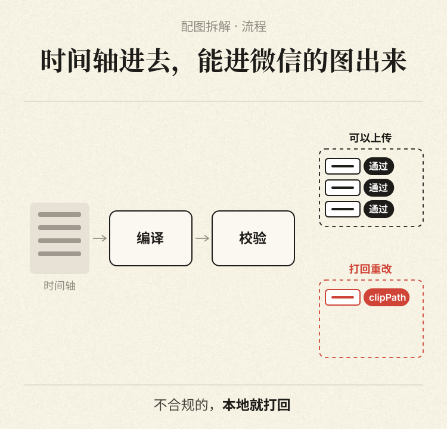
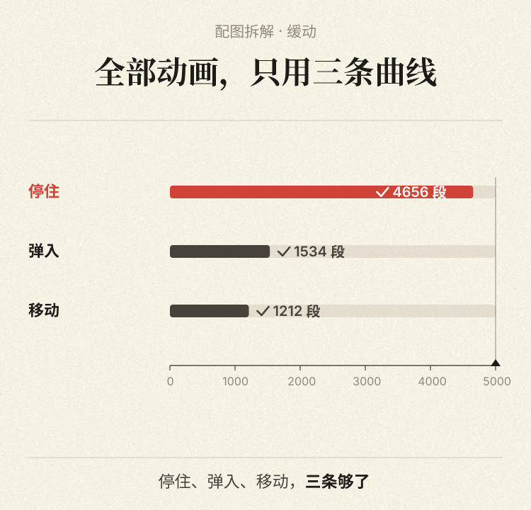

# heige-svg | 黑哥的公众号动图工具

> 给公众号文章配上会动的图。

中文 | [English](README.en.md)

写教程，有些过程光靠文字确实费劲。鼠标点了哪儿，命令怎么跑，数据怎么变，动起来就好讲多了。

heige-svg 把这些过程做成 SVG 动画。你写正文、填数据、排时间轴，它负责生成配图和文章预览。要改一句话、换一个数字，改完脚本重新编译就行。

工具里放了 8 个常用场景：终端、界面点击、数据对比、流程分流、手机对话等。也附了 Claude Code skill，可以让它按文章内容选场景、写脚本、编译和检查。

<p>
  
  
  
  
</p>

**先把边界说清楚：这还是一个实验项目。** 本地编译、校验、抽帧和 Chrome 手机宽度下的播放已验证。发布脚本只通过了本地模拟服务测试，**还没有向真实公众号发过草稿，也没有在手机微信里确认过播放**。草稿接口是否完整保留 SVG 动画，目前仍待验证。

输出是内联 SVG + SMIL 动画和文章 HTML，适合用来研究公众号配图、做本地演示。要用于真实公众号，先用自己的测试稿走一遍草稿读取和手机预览。

## 快速开始

需要 Node.js 20+、Python 3 和已安装的 Google Chrome。抽帧工具默认使用本机 Chrome；安装在其他位置时，可以通过 `CHROME_PATH` 指定可执行文件。

```bash
git clone https://github.com/HeiGeAi/heige-svg.git
cd heige-svg
npm ci
npm run fonts   # 下载字体，约 13MB
npm run demo    # 编译示例文章并抽帧
```

运行后会生成：

- `out/demo/preview.html`：手机宽度的文章预览，动画实时播放
- `out/demo/qa/sheet.png`：每张图的抽帧总览
- `out/demo/article.html`：文章正文 HTML，内含 SVG 动画
- `out/demo/fig*.svg`：各张配图的 SVG 源码

在 macOS 上可以直接打开预览：

```bash
open "$(pwd)/out/demo/preview.html"
```

## 换成你自己的内容

新建一个 `.mjs` 脚本，正文和配图按顺序写。下面的模型名和数字只用于演示结构，发布前换成自己的真实内容：

```js
export default {
  title: '文章标题',
  blocks: [
    { p: '正文。支持 **标红加粗** 和 `代码`' },
    {
      scene: 'barRace',
      meta: {
        eyebrow: '对象 · 这一节',
        title: '同样的文档，它认得最快',   // 标题写结论，不写名词
        foot: [{ t: '认完 1000 页，' }, { t: '约 14 分钟', b: true }],
      },
      data: {
        rows: [
          { name: '模型 A', value: 13.7, label: '13.7 分钟', hero: true },
          { name: '模型 B', value: 20.4, label: '20.4 分钟' },
        ],
        tick: 5,
      },
    },
    { h: '小标题' },
    { ul: ['列表项一', '列表项二'] },
    { quote: '给读者复制的一句话' },
  ],
};
```

```bash
node bin/build.mjs 我的文章.mjs out/我的文章   # 编译并校验
node bin/qa.mjs out/我的文章                   # 抽帧检查
```

## 场景模板

| 模板 | 适合 |
|---|---|
| `terminalRun` | agent 跑任务、安装、一句话搞定 |
| `uiClick` | 产品操作教程，光标点击翻屏 |
| `barRace` | 速度、数量对比，主角标红 |
| `gridWall` | 全量 vs 局部的左右对比 |
| `pipeline` | 系统流程和分流 |
| `phoneChat` | 手机 App 演示 |
| `timelineList` | 事件列表、时间线 |
| `rankCards` | 多组榜单、数据卡 |

配色用 `meta.theme`：`paper`（默认）、`mono`、`amber`、`blue`，也可以在 `src/motion.mjs` 的 `THEMES` 里加自己的。

模板不够时，用底层动效自己拼（打字机、光标、波纹、扫描线、数字滚动、序列帧等），见 [docs/writing-scenes.md](docs/writing-scenes.md) 和 [examples/primitives.mjs](examples/primitives.mjs)。

## 发到草稿箱（实验功能）

默认只演练，打印计划，不联网。加上 `--send` 才会上传素材并创建草稿。

```bash
# 演练：不联网，只打印计划
python3 bin/publish.py out/我的文章 --cover 封面.jpg

# 真发：上传素材，创建草稿，再读回来核对标签有没有被改
export WECHAT_APPID=...  WECHAT_APPSECRET=...
python3 bin/publish.py out/我的文章 --cover 封面.jpg --send
```

多账号用 `--account NAME`，对应环境变量 `WECHAT_NAME_APPID` 和 `WECHAT_NAME_APPSECRET`。运行机器的公网 IP 要加进公众号的 IP 白名单。

脚本用 `stable_token` 接口获取 token，未启用强制刷新。

**建议先发一篇小测试稿**：看读回核对的结果，再在手机上预览。如果动画被过滤或接口报 45002，欢迎开 issue 记录。

## 为什么这样写

引擎将 SVG 的标签和动画属性限制在较小的范围内，动画只动 `opacity` 和 `transform`，单张图的动画共用一个循环。校验器会拒绝 `id`、`clipPath`、`mask`、渐变、滤镜等写法。

设计依据记录在 [技术拆解](docs/analysis.md) 中，包含对 5 篇公开文章、49 张动图的观察。这些观察用于约束输出，不能代替本工具的真实公众号验证。

## 配合 Claude Code 使用

这个仓库本身就是一个 skill：

```bash
mkdir -p ~/.claude/skills
ln -s "$(pwd)" ~/.claude/skills/heige-svg
```

之后对 Claude 说「用 heige-svg 给这篇稿子配动图」。流程见 [SKILL.md](SKILL.md)。

## 开发

```bash
npm test           # 单元测试，发布流程走本地假服务器，不碰微信
npm run showcase   # 重新生成 README 的演示图
```

本地测试覆盖动画时间轴、8 个场景模板、标签校验，以及草稿发布脚本的演练和模拟发送流程。测试通过不代表微信兼容性已经通过。

## 致谢与声明

由 [问问黑哥（HeiGeAi）](https://github.com/HeiGeAi) 维护。

手法观察自公众号「赛博禅心」的公开文章。这是一份独立的技术总结，与原作者无关，也未获其背书。仓库不包含原文的配图、素材和代码。纸纹是程序生成的，字体在安装时下载，均为 SIL OFL 授权。

用这个工具时，请使用自己的内容和素材；图里的数据和界面要真实，模拟产品界面时不要冒充官方截图。

## 许可

代码以 [MIT](LICENSE) 协议开源。使用和分发时保留许可证中的版权声明。
